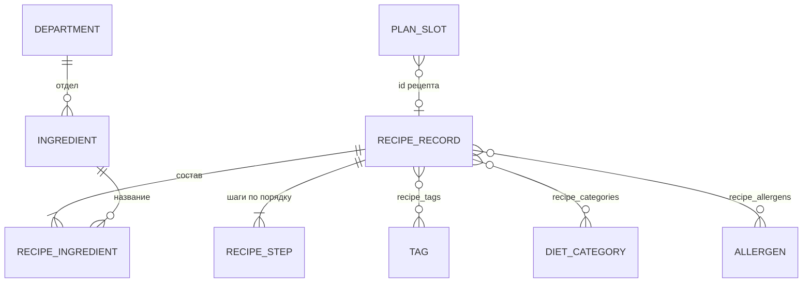

# Архитектура данных Tarelka — прототип 1.0

**Версия:** 1.4  
**Дата:** 24 ноября 2026  
**Обновлено:** 24 ноября 2026 — добавлены сущности Supabase Auth и RLS; каталог рецептов перенесён в БД; описан серверный API (§10); добавлен контракт клиентской интеграции (§11)  
**Статус:** логическая схема данных по `docs/prd-prototype.md`; описание текущего поведения — в `docs/spec.md`  
**Источники:** `docs/prd-prototype.md` (FR-01–FR-22, §8.1–§8.4), `docs/spec.md` (§1, §3, §5), `js/data.js`, `js/app.js`

> Ниже описаны логические сущности прототипа: как они связаны, где живут и какие из них хранятся, а какие вычисляются на лету. Первоначально хранение описывалось как один ключ `localStorage` плюс статический каталог в `js/data.js`; с 24 ноября 2026 источником истины для пользовательских данных и для каталога становится Postgres (§8, §9), а `js/data.js` остаётся резервным офлайн-источником. Раздел 11 фиксирует согласованный контракт подключения клиента к Supabase до начала реализации.

## 1. Граница модели

| Категория | Сущности | Где находятся | Хранятся ли |
| :-- | :-- | :-- | :-- |
| **Состояние пользователя** | `AppState`, `Profile`, `WeekPlan`, `Day`, `ManualItem`, `CheckedMark` | `tarelka:state` | Да, в одном JSON-объекте версии 1 |
| **Статический справочник** | `Recipe`, `Ingredient`, `Department`, `IngredientCategory`, `DietCategory`, `Allergen`, `Tag` | `js/data.js` | Да, в коде; пользователем не меняется |
| **Производные данные** | `ShoppingLine` | Вычисляется при открытии «Покупок» | Нет |
| **UI-состояние** | `DiscoverFilter` | Память текущего экрана | Нет |
| **Серверное состояние (новое)** | `AuthUser`, `UserProfile`, `WeekPlanRecord`, `CheckedItemRecord`, `ManualItemRecord`, `ImportRecord` | Supabase Auth + Postgres | Да, источник истины с 24 ноября 2026 |
| **Каталог в БД (новое)** | `RecipeRecord`, `RecipeStep`, `Ingredient`, `RecipeIngredient`, `Department`, `Tag`, `Allergen`, `DietCategory` и junction-таблицы | Postgres, схема `public` | Да, источник истины с 24 ноября 2026 |

Ключевое правило: **список покупок не хранится**. Он каждый раз выводится из плана, профиля, ручных позиций и отметок (PRD-прототип, FR-06).

> Изменение скоупа (24 ноября 2026): источником истины становится сервер Supabase/Postgres. Строки таблицы выше сохраняют описание прототипа: локальное состояние теперь служит офлайн-кэшем и используется для одноразового импорта при первом входе. Решения — `docs/prd-prototype.md` §8.2; `AGENTS.md` не менялся.

> Второе изменение скоупа (24 ноября 2026): каталог из `js/data.js` перенесён в БД в нормализованном виде (§9). Строка «Статический справочник» выше показывает прежнее состояние прототипа; `js/data.js` не удаляется и используется как офлайн-резерв. Решения — `docs/prd-prototype.md` §8.3.

## 2. Сущности

| Сущность | Поля | Назначение |
| :-- | :-- | :-- |
| **AppState** | `version: 1`, `profile`, `plan`, `checked`, `manual`, `updatedAt` | Корневой агрегат. Один ключ `tarelka:state`. |
| **Profile** | `onboarded: boolean`, `diet: DietCategory`, `allergies: Allergen[]`, `people: 2\|4\|6` | Ответы онбординга (3 шага) и «Моих предпочтений». |
| **WeekPlan** | `days: Day[7]` | Одна активная неделя. Даты в состоянии не хранятся: рабочая неделя вычисляется от текущего понедельника. |
| **Day** | `breakfast: RecipeId\|null`, `lunch: RecipeId\|null`, `dinner: RecipeId\|null` | День с тремя фиксированными слотами (решение §8.1 №3). Заметок в прототипе нет. |
| **Recipe** | `id`, `title`, `time`, `servings`, `tags: Tag[]`, `categories: DietCategory[]`, `allergens: Allergen[]`, `intro`, `image`, `ingredients: Ingredient[]`, `steps: string[]` | Статический рецепт. Один рецепт может входить в несколько категорий. |
| **Ingredient** | `name`, `amount: string`, `unit` | Строка ингредиента внутри рецепта. `amount: ''` вместе с `unit: 'по вкусу'` означает «по вкусу» и не умножается. |
| **ManualItem** | `id`, `name`, `amount`, `dept: DepartmentKey`, `source: 'вручную'\|'из рецепта'` | Ручная позиция списка покупок. Не исчезает при изменении плана (FR-07). |
| **CheckedMark** | `key: string` → `true` | Отметка купленного. Отсутствие ключа означает «не куплено». |
| **Department** | `key`, `title` | Справочник отделов: `veg`, `meat`, `dairy`, `pantry`, `spices`, `frozen`, `other`. Порядок фиксированный. |
| **IngredientCategory** | `name` → `DepartmentKey` | Соответствие точного названия ингредиента отделу. Нет совпадения → `other`. |
| **ShoppingLine** | `key`, `dept`, `name`, `unit`, `amount`, `done: boolean`, `sources` | Строка списка покупок. Вычисляется, не сохраняется. |
| **DiscoverFilter** | `query`, `time`, `mealType`, плюс `diet` и `allergies` из профиля | Несохраняемые фильтры подборки. Поиск и «до 20 минут» работают (решение §8.1 №1). |
| **AuthUser** | `id: uuid`, `email`, `created_at` | Пользователь Supabase Auth. Сущность управляется провайдером, приложением не создаётся. |
| **UserProfile** | `user_id`, `onboarded`, `diet`, `allergies[]`, `people`, `updated_at` | Серверная копия `Profile`. 1:1 с `AuthUser`. |
| **WeekPlanRecord** | `id`, `user_id`, `days: jsonb`, `updated_at` | Одна активная неделя на пользователя; `days` — те же 7 дней × 3 слота. |
| **CheckedItemRecord** | `user_id`, `key`, `done` | Серверная копия отметки. Ключ тот же, что и локальный. |
| **ManualItemRecord** | `user_id`, `id`, `name`, `amount`, `dept`, `source` | Серверная копия ручной позиции. |
| **ImportRecord** | `user_id`, `imported_at`, `source` | Признак выполненного одноразового импорта localStorage. |

### Перечисления

- `DietCategory`: `none` (Без ограничений), `protein`, `light`, `gentle`. `none` не фильтрует каталог.
- `Allergen`: `gluten`, `nuts`, `milk`, `eggs`, `fish`, `soy` — фиксированный список из шести.
- `MealSlot`: `breakfast`, `lunch`, `dinner`.
- `DepartmentKey`: `veg`, `meat`, `dairy`, `pantry`, `spices`, `frozen`, `other`.
- `Tag`: метки рецепта (`Завтрак`, `Обед`, `Ужин`, `Быстро`, `Суп` и др.); используется фильтром по приёму пищи.
- `Unit`: `г`, `мл`, `шт`, `зуб.`, `банка`, `ломтика`, `ст. л.`, `ч. л.`, `по вкусу` (пустое количество).

## 3. Связи

```mermaid
erDiagram
    APP_STATE ||--|| PROFILE : "1:1 содержит"
    APP_STATE ||--|| WEEK_PLAN : "1:1 содержит"
    WEEK_PLAN ||--|{ DAY : "7 дней"
    DAY ||--|{ MEAL_SLOT : "3 слота"
    MEAL_SLOT }o--o| RECIPE : "RecipeId или null"
    RECIPE ||--|{ INGREDIENT : "состав"
    RECIPE }o--o| DIET_CATEGORY : "categories"
    RECIPE }o--o| ALLERGEN : "allergens"
    RECIPE }o--o| TAG : "tags"
    INGREDIENT }o--|| DEPARTMENT : "по названию"
    APP_STATE ||--o{ MANUAL_ITEM : "manual"
    APP_STATE ||--o{ CHECKED_MARK : "checked"
    SHOPPING_LINE }o--o| CHECKED_MARK : "совпадение ключа"
    DISCOVER_FILTER }o--|| PROFILE : "наследует ограничения"
    AUTH_USER ||--|| USER_PROFILE : "1:1"
    AUTH_USER ||--o{ WEEK_PLAN_RECORD : "владелец"
    AUTH_USER ||--o{ CHECKED_ITEM_RECORD : "владелец"
    AUTH_USER ||--o{ MANUAL_ITEM_RECORD : "владелец"
    AUTH_USER ||--o| IMPORT_RECORD : "импорт один раз"
    WEEK_PLAN_RECORD ||--|{ PLAN_SLOT : "21 слот"
    PLAN_SLOT }o--o| RECIPE : "RecipeId или null"
    APP_STATE ..> IMPORT_RECORD : "импорт при первом входе"
```

Пояснения к мощности связей:

1. **AppState → Profile / WeekPlan** — ровно по одному вложенному объекту.
2. **WeekPlan → Day** — ровно 7 элементов; `plan` нормализуется до длины 7 при загрузке.
3. **Day → MealSlot** — ровно три слота: завтрак, обед, ужин. Слот не отдельный объект в JSON, а поле дня; в схеме показан как логическая сущность.
4. **MealSlot → Recipe** — `0..1`: в ячейке лежит `id` рецепта или `null`. Неизвестный `id` при загрузке превращается в `null`.
5. **Recipe → Ingredient** — один или несколько ингредиентов.
6. **Recipe → DietCategory / Allergen / Tag** — связи «многие ко многим» через массивы `categories`, `allergens`, `tags`. Отдельных таблиц связей нет.
7. **Ingredient → Department** — через справочник `ingredientCategories` по точному `name`; при отсутствии записи используется `other`.
8. **AppState → ManualItem / CheckedMark** — ноль или много. Ручные позиции — массив, отметки — объект-словарь.
9. **ShoppingLine → CheckedMark** — логическая связь по ключу, без внешнего ключа в хранилище.
10. **AuthUser → UserProfile** — ровно одна строка профиля на пользователя; `user_id` — внешний ключ на `auth.users.id`.
11. **AuthUser → WeekPlanRecord / CheckedItemRecord / ManualItemRecord** — один ко многим; активная неделя одна за счёт `unique(user_id)`.
12. **WeekPlanRecord → PlanSlot** — 21 логический слот внутри `days: jsonb`; связь с `Recipe` та же, что у локального `MealSlot`.
13. **AuthUser → ImportRecord** — ноль или одна запись; она делает импорт localStorage одноразовым.

## 4. Ключи и вывод списка покупок

### 4.1. Ключи отметок

| Тип строки | Ключ | Пример |
| :-- | :-- | :-- |
| Из плана | `plan\|{dept}\|{name}\|{unit}` | `plan\|veg\|Томаты\|шт` |
| Ручная | `manual\|{id}` | `manual\|m1730553600000` |

Ключ не зависит от количества, поэтому отметка переживает изменение порций. Удаление продукта из плана убирает строку из списка, но не чистит запись в `checked` — такой «мусор» безвреден и удаляется только при полном сбросе.

### 4.2. Вывод `ShoppingLine`

Для каждого слота плана со ссылкой на рецепт:

```text
factor = profile.people / recipe.servings
amount = ingredient.amount × factor
dept   = ingredientCategories[ingredient.name] || 'other'
```

Далее:

1. Ингредиенты с одинаковыми `name` + `unit` + `dept` суммируются в одну строку.
2. Разные единицы того же продукта остаются отдельными строками.
3. `по вкусу` выводится один раз и не умножается.
4. Округление по единице: штучные — вверх до целого; граммы и миллилитры — до 5; ложки — до 0,5; не более одного знака после запятой.
5. Ручные позиции добавляются к тем же строкам при совпадении имени и единицы, иначе создают новую строку с бейджем источника.
6. `done = checked[key] === true`.

Строки группируются по отделам в фиксированном порядке из `data.departments`.

## 5. Ограничения целостности

- `version` всегда `1`; неизвестная версия или повреждённый JSON не загружаются.
- `diet` — одно из четырёх значений; старые `vegetarian` / `vegan` / `pescatarian` при загрузке становятся `none`.
- `allergies` — подмножество шести допустимых аллергенов; `people` — только `2`, `4`, `6`.
- `plan` — ровно 7 дней, каждый с тремя слотами; невалидные `id` рецептов заменяются на `null`.
- `manual`: не более 300 позиций, имя не пустое и не длиннее 80 символов, `amount` не длиннее 40 символов.
- Повреждённое сырое значение копируется в `tarelka:state:corrupt`, приложение стартует с дефолтным состоянием; ошибка записи показывается тостом и не ломает интерфейс.
- Значения, введённые пользователем, выводятся как текст, а не как HTML.

## 6. Пример состояния

```json
{
  "version": 1,
  "profile": {
    "onboarded": true,
    "diet": "protein",
    "allergies": ["gluten"],
    "people": 4
  },
  "plan": [
    { "breakfast": "oatmeal", "lunch": "soup", "dinner": "pasta" },
    { "breakfast": null, "lunch": null, "dinner": null }
  ],
  "checked": { "plan|veg|Томаты|шт": true },
  "manual": [
    {
      "id": "m1730553600000",
      "name": "Бумажные полотенца",
      "amount": "",
      "dept": "other",
      "source": "вручную"
    }
  ],
  "updatedAt": "2026-11-24T10:00:00.000Z"
}
```

В примере показаны только первые два дня плана; в реальном состоянии их ровно семь.

## 7. Намеренно отсутствующие сущности

Согласно `docs/prd-prototype.md` §8.1, в схеме прототипа нет:

- сущности **Template** / сохранённой недели;
- сущности **Note** (заметки к дню);
- сущности **Dislike** (нелюбимые продукты);
- истории недель, нескольких планов и хранимых дат;
- отдельной сущности **ShoppingList** — список всегда производный;
- полей калорий, БЖУ и времени жизни таймеров.

Они остаются в целевом `docs/prd.md` как планы на будущее и в этой схеме не моделируются.

## 8. Авторизация и серверное хранение (новое направление)

Решения от 24 ноября 2026 зафиксированы в `docs/prd-prototype.md` §8.2. `AGENTS.md` не менялся.

### 8.1. Серверные таблицы

| Таблица в Postgres | Назначение | Ключ владельца | RLS |
| :-- | :-- | :-- | :-- |
| `auth.users` | Пользователи Supabase Auth. Управляется провайдером. | `id` | Не настраивается вручную |
| `public.profiles` | Профиль: `onboarded`, `diet`, `allergies`, `people`, `updated_at`. | `user_id` → `auth.users.id` | `user_id = auth.uid()` на SELECT/INSERT/UPDATE |
| `public.week_plans` | Одна активная неделя: `id`, `user_id`, `days jsonb`, `updated_at`. | `user_id` | `user_id = auth.uid()` на всех операциях; `unique(user_id)` |
| `public.checked_items` | Отметки покупок: `user_id`, `key`, `done`. | `user_id` | `user_id = auth.uid()` |
| `public.manual_items` | Ручные позиции: `user_id`, `id`, `name`, `amount`, `dept`, `source`. | `user_id` | `user_id = auth.uid()` |
| `public.imports` | Признак одноразового импорта: `user_id`, `imported_at`, `source`. | `user_id` | `user_id = auth.uid()` |

Рецепты, отделы и соответствия ингредиентов остаются статическими (`js/data.js`) и не требуют RLS: они доступны всем пользователям только на чтение. **Позже решение пересмотрено:** каталог перенесён в БД, где для его таблиц включён RLS с политикой чтения (§9); эта строка оставлена как история.

### 8.2. Политики RLS

- Все пользовательские таблицы включают RLS; политики сравнивают `user_id` с `auth.uid()`.
- Политика `USING` отвечает за чтение и обновление видимых строк, `WITH CHECK` — за вставку строки только от имени себя.
- `DELETE` разрешён только владельцу строки. Каскадное удаление профиля при удалении пользователя — через FK `on delete cascade`.
- Для `public.imports` доступ ужесточён: клиенту разрешены только `SELECT` и `INSERT` своих строк (`imports_select_own`, `imports_insert_own`); `UPDATE` и `DELETE` не предоставляются ни через RLS, ни через GRANT. Это исключает повторный импорт после удаления отметки.
- RLS не действует на `TRUNCATE`: политика `USING` не может ограничить очистку всей таблицы. Поэтому у ролей `anon` и `authenticated` право `TRUNCATE` на все таблицы `public` отзывается миграцией `20261124143000_truncate_grants.sql`. Права `service_role` в этой задаче не изменяются.
- Сервисный ключ обходит RLS и используется только для служебных операций, не в клиентском коде.

### 8.3. Сопоставление localStorage и сервера

| Локальное поле | Серверная таблица | Комментарий |
| :-- | :-- | :-- |
| `profile` | `public.profiles` | Те же четыре поля. |
| `plan` | `public.week_plans.days` | Массив из 7 дней × 3 слота без изменений. |
| `checked` | `public.checked_items` | Одна строка на ключ с `done = true`. |
| `manual` | `public.manual_items` | Идентификаторы сохраняются. |
| `version`, `updatedAt` | служебные поля / `updated_at` | `tarelka:state:corrupt` на сервер не переносится. |

Импорт выполняется один раз при первом входе: клиент читает `tarelka:state`, проверяет версию 1, вставляет строки от имени `auth.uid()` и записывает `public.imports`. При повторном входе импорт не повторяется. После успешного импорта сервер становится источником истины, а локальный ключ используется как офлайн-кэш.

### 8.4. Что меняется в модели

- `AppState` и вложенные сущности остаются локальным представлением; их серверные аналоги — `UserProfile`, `WeekPlanRecord`, `CheckedItemRecord`, `ManualItemRecord`.
- `ShoppingLine` по-прежнему вычисляется, теперь — из серверных данных или их локального кэша.
- Статический каталог рецептов не переносится в БД в этой итерации. **Позже решение пересмотрено:** каталог перенесён в БД, см. §9; эта строка оставлена как история.

## 9. Каталог рецептов в Postgres (новое направление)

Согласовано 24 ноября 2026: все данные из `js/data.js` переносятся в БД в нормализованном виде. Источник истины — Postgres; `js/data.js` не удаляется и остаётся резервным офлайн-источником. Решения — `docs/prd-prototype.md` §8.3.

### 9.1. Сущности и таблицы

| Сущность | Таблица | Поля | Ключ |
| :-- | :-- | :-- | :-- |
| `RecipeRecord` | `public.recipes` | `id`, `title`, `time`, `servings`, `intro`, `image`, `created_at` | `id` (slug из `data.js`) |
| `RecipeStep` | `public.recipe_steps` | `recipe_id`, `step_no`, `body` | (`recipe_id`, `step_no`) |
| `Ingredient` | `public.ingredients` | `name`, `department_key` | `name` (точное название) |
| `RecipeIngredient` | `public.recipe_ingredients` | `recipe_id`, `ingredient_name`, `amount`, `unit`, `position` | (`recipe_id`, `ingredient_name`) |
| `Department` | `public.departments` | `key`, `title`, `sort_order` | `key` |
| `Tag` | `public.tags` | `name` | `name` |
| `Allergen` | `public.allergens` | `key` | `key` |
| `DietCategory` | `public.diet_categories` | `key` | `key` |
| Связь рецепт–тег | `public.recipe_tags` | `recipe_id`, `tag_name` | (`recipe_id`, `tag_name`) |
| Связь рецепт–категория | `public.recipe_categories` | `recipe_id`, `category_key` | (`recipe_id`, `category_key`) |
| Связь рецепт–аллерген | `public.recipe_allergens` | `recipe_id`, `allergen_key` | (`recipe_id`, `allergen_key`) |

`ingredientCategories` из `data.js` превращается в поле `ingredients.department_key`: отдельный справочник соответствий не нужен. Ингредиенты без совпадения получают `other`, как и в прототипе. `RecipeIngredient.amount` остаётся строкой (`'0,5'`, `''` для «по вкусу»), чтобы не менять правила округления из §4.2.

### 9.2. Связи



Связь `PLAN_SLOT → RECIPE_RECORD` логическая: в `week_plans.days` по-прежнему лежит `id` рецепта, но теперь триггер `validate_week_plan()` проверяет его существование в `public.recipes` вместо справочника в коде.

### 9.3. Сид и границы переноса

- В БД переносятся: 18 рецептов, их шаги и ингредиенты, 7 отделов, все соответствия `ingredientCategories`, а также множества тегов, категорий и аллергенов.
- Демо-неделя из `data.js` **не сидируется**: это состояние пользователя, а не каталог.
- Путь `assets/recipes/*.svg` хранится в `recipes.image` как текст; сами SVG-файлы остаются в проекте и не переносятся в Supabase Storage в этой итерации.
- Миграции: `supabase/migrations/20261124140000_catalog_schema.sql` (структура), `20261124140100_catalog_seed.sql` (данные) и `20261124141000_catalog_indexes.sql` (индексы под внешние ключи).

### 9.4. Права доступа

- На всех таблицах каталога включён RLS и создана политика чтения `catalog_read` для `anon` и `authenticated`: `using (true)`.
- Политик INSERT/UPDATE/DELETE для клиентских ролей нет: каталог меняется только через `service_role` и миграции.
- `anon` и `authenticated` получают `SELECT`; запись им не предоставляется. Это отличает каталог от пользовательских таблиц §8, где каждая строка привязана к `user_id`.

### 9.5. Сопоставление `data.js` → БД

| Источник в `js/data.js` | Таблица / поле |
| :-- | :-- |
| `recipes[].id/title/time/servings/intro/image` | `recipes` — одноимённые поля |
| `recipes[].steps` | `recipe_steps` (`step_no` — индекс + 1) |
| `recipes[].ingredients` | `recipe_ingredients` + `ingredients` |
| `recipes[].tags` | `tags` + `recipe_tags` |
| `recipes[].categories` | `diet_categories` + `recipe_categories` |
| `recipes[].allergens` | `allergens` + `recipe_allergens` |
| `departments` | `departments` (`sort_order` — порядок в массиве) |
| `ingredientCategories` | `ingredients.department_key` |

### 9.6. Клиентская часть

В задаче переноса каталога код приложения не менялся: `js/app.js` по-прежнему читает `window.TARELKA` из `js/data.js`. Переключение чтения на API Supabase — отдельная согласованная фича; её контракт описан в §11. Документ `docs/spec.md` описывает поведение прототипа до переключения.

## 10. Серверный API (RPC)

Согласовано 24 ноября 2026: операции с пользовательскими данными и сборка покупок предоставляются функциями Postgres в схеме `public` и вызываются через Supabase REST/RPC. В задаче создания API клиент не менялся (§9.6); подключение фронта описано в §11. Решения — `docs/prd-prototype.md` §8.4.

### 10.1. Принципы

- Одна операция — одна функция RPC. Прямая запись в пользовательские таблицы клиенту не нужна; RLS остаётся включённым.
- Функции выполняются с правами вызывающего (`security invoker`): политики `user_id = auth.uid()` и обычные проверки прав действуют как при прямых запросах.
- Каждая пользовательская функция проверяет `auth.uid()` и выбрасывает исключение без вошедшего пользователя. `EXECUTE` на функции получает только `authenticated`; `public` и `anon` доступ отзывается.
- Список покупок не хранится (FR-06): он вычисляется из `week_plans.days`, `profiles.people`, `manual_items` и `checked_items`.
- В задаче создания API профиль только читается. Если строки профиля нет, множитель людей принимается равным `4` — значению по умолчанию из `profiles.people`. При подключении фронта профиль читается и пишется прямым REST (§11.4); новые RPC не нужны.
- План нормализуется так же, как при загрузке `localStorage` (§5): ровно 7 дней по 3 слота, неизвестные `id` рецептов заменяются на `null`.

### 10.2. Контракт функций

| Функция | Аргументы | Возврат | Назначение |
| :-- | :-- | :-- | :-- |
| `public.api_get_plan()` | — | `jsonb` | `days` текущего пользователя или план из 7 пустых дней, если записи ещё нет. |
| `public.api_set_plan(p_days jsonb)` | `p_days` — массив дней | `jsonb` | Полная замена недели; возвращает сохранённый нормализованный план. |
| `public.api_set_meal(p_day integer, p_slot text, p_recipe_id text default null)` | `p_day` — 0…6; `p_slot` — `breakfast`, `lunch`, `dinner`; `p_recipe_id` — `id` или `null` | `jsonb` | Назначает или очищает одну ячейку; возвращает обновлённый план. |
| `public.api_get_shopping()` | — | `jsonb` | Собранный список покупок: массив групп отделов. |
| `public.api_add_manual(p_name text, p_amount text default '', p_dept text default 'other', p_source text default 'вручную')` | параметры ручной позиции | `text` | Добавляет позицию в отдел по умолчанию `other`, возвращает её `id`. |
| `public.api_remove_manual(p_id text)` | `p_id` —	id позиции | `boolean` | Удаляет ручную позицию и её отметку; `true`, если позиция была. |
| `public.api_set_checked(p_key text, p_done boolean default true)` | `p_key` — ключ позиции | `boolean` | Ставит или снимает отметку; возвращает `true`. |
| `public.api_unset_checked(p_key text)` | `p_key` — ключ позиции | `boolean` | Удаляет запись об отметке; `true`, если она была. |
| `public.shopping_parse_amount(p_amount text)` | строка количества | `numeric` | Разбор числа; `null` для пустого или нечислового значения. |
| `public.shopping_round(p_value numeric, p_unit text)` | значение и единица | `numeric` | Округление по правилам §10.4. |
| `public.format_shopping_amount(p_value numeric)` | значение | `text` | Число с десятичной запятой и не более чем одним знаком после неё. |

Все функции объявлены с явным `search_path = public`; пользовательские проверки и запись идут от имени `auth.uid()`.

### 10.3. Формат плана и покупок

`api_get_plan()` и `api_set_meal()` возвращают массив из 7 объектов с ключами `breakfast`, `lunch`, `dinner`; значение — `id` рецепта или `null`.

`api_get_shopping()` возвращает массив групп в порядке `departments.sort_order`, только непустые группы:

```json
[
  {
    "key": "veg",
    "title": "Овощи",
    "items": [
      {
        "key": "plan|veg|Томаты|шт",
        "name": "Томаты",
        "dept": "veg",
        "source": "из плана",
        "manualId": null,
        "amountText": "5 шт",
        "done": false
      }
    ]
  }
]
```

Порядок элементов внутри группы: сначала ингредиенты плана в порядке дней и слотов, затем ручные позиции в порядке добавления. Позиции, добавленные из рецепта, имеют `source = "из рецепта"` и ключ `manual|<id>`.

### 10.4. Алгоритм сборки покупок

1. Для каждого слота плана берётся рецепт; множитель `factor = people / recipe.servings`.
2. Количество ингредиента разбирается из строки (`shopping_parse_amount`); пустое или нечисловое значение означает «по вкусу» и не участвует в сумме.
3. Отдел берётся из `ingredients.department_key`; при отсутствии строки — `other`.
4. Ингредиенты с одинаковыми отделом, названием и единицей складываются в одну позицию по ключу `plan|<dept>|<name>|<unit>`. **Суммирование идёт по сырым значениям до округления.**
5. Итог округляется по единице:

| Единица | Правило |
| :-- | :-- |
| `шт`, `шт.`, `зуб.`, `банка`, `ломтика` | `max(1, ceil(value - 1e-9))` |
| `г`, `мл` | `max(5, round(value / 5) × 5)` |
| `ст. л.`, `ч. л.` | `max(0.5, round(value × 2) / 2)` |
| Остальные | `round(value, 1)` |

6. Если у позиции нет числового количества, `amountText` равен единице или «по вкусу»; иначе — округлённое число и единица через пробел.
7. Ручные позиции добавляются отдельными строками с ключом `manual|<id>`, их `amount` не округляется.
8. `done = true` только если в `checked_items` есть строка с этим ключом и `done = true`. Отметка не зависит от количества и переживает пересборку плана.

### 10.5. Ограничения и ошибки

- Нет вошедшего пользователя (`auth.uid()` пуст) — исключение до любой операции.
- `p_days` не массив — исключение; массив другой длины нормализуется до 7 дней.
- `p_day` вне `0…6` или неизвестный `p_slot` — исключение.
- Имя ручной позиции: 1…80 символов; `amount` не длиннее 40; отдел — один из семи ключей; `source` — `вручную` или `из рецепта`. Ограничения уже есть в `manual_items`, API дополнительно нормализует отдел к `other` для неизвестного значения.
- Ключ отметки должен удовлетворять существующему CHECK-ограничению `checked_items_key_format`.
- Ошибки записи в `week_plans` и `checked_items` остаются видимыми вызывающему: API не подавляет их.

### 10.6. Исправление триггера плана

`validate_week_plan()` вызывал несуществующую функцию `jsonb_object_length(jsonb)`, из-за чего любая запись `week_plans.days` падала. Миграция `20261124150000_validate_week_plan_fix.sql` заменяет проверку на:

```sql
(select count(*) from jsonb_object_keys(day_value)) <> 3
```

Остальные проверки триггера (7 дней, объект-день, три слота, существование `id` рецепта) сохраняются.

При разработке нашёлся второй дефект: `to_jsonb(NULL)` возвращает SQL `NULL`, а не `jsonb null`, поэтому `jsonb_set()` в `api_set_meal()` обнулял весь план при очистке ячейки. Миграция `20261124153000_api_set_meal_null_fix.sql` подставляет `'null'::jsonb` для пустого `p_recipe_id` и заново выдаёт права на функцию.

### 10.7. Тесты и порядок разработки

- Тесты пишутся на pgTAP в `supabase/tests/`; расширение устанавливается в служебную схему `extensions` отдельной миграцией `20261124151000_pgtap_extension.sql`.
- `api_plan_tests.sql` проверяет CRUD плана, нормализацию, валидацию триггера, изоляцию по `auth.uid()` и отсутствие прав у `anon`.
- `api_shopping_tests.sql` проверяет округление по всем группам единиц, дедупликацию до округления, «по вкусу», ручные позиции и отметки.
- Каждый файл выполняется в транзакции с `rollback`: тестовые пользователи и строки не сохраняются.
- Порядок TDD: сначала прогнать тесты без функций (красный этап), затем применить миграции с триггером и API и прогнать до зелёного этапа.
- Результат: красный этап подтверждён ошибками `42883` на отсутствующих функциях; зелёный этап — 16/16 в `api_plan_tests.sql` и 37/37 в `api_shopping_tests.sql`.
- Фикстура покупок использует два тестовых рецепта с одинаковыми ингредиентами: в каталоге `(recipe_id, ingredient_name)` — первичный ключ, поэтому дублирование внутри одного рецепта невозможно. Дедупликация проверяется между разными слотами плана.

## 11. Клиентская интеграция с Supabase (согласованный контракт)

Согласовано 24 ноября 2026: фронт подключается к готовому серверному API, но код приложения в этой документальной задаче ещё не меняется. Решения — `docs/prd-prototype.md` §8.5; пользовательские состояния — `docs/ux-flows.md` §2.11, §3.4 и §4.9.

### 11.1. Состав клиентского слоя

| Файл / ключ | Назначение |
| :-- | :-- |
| `js/config.js` | Экспорт адреса проекта Supabase и publishable key через `window.TARELKA_CONFIG`. Секретов нет. |
| `js/api.js` | Общий слой запросов: заголовки, разбор ответов, ошибки, обновление сессии, вызовы Auth/REST/RPC. |
| `js/app.js` | Показывает данные API в существующих экранах и управляет состоянием входа/кэша. |
| `tarelka:auth` | Отдельный ключ сессии: access token, refresh token, срок действия и базовая информация о пользователе. |
| `tarelka:state` | Офлайн-кэш прикладного состояния версии 1; после входа не является источником истины. |

`js/data.js` и локальные SVG не удаляются: они остаются резервным источником каталога для офлайн-чтения.

### 11.2. Авторизация

- Вход и регистрация: `POST /auth/v1/signup` и `POST /auth/v1/token?grant_type=password` с email и паролем. В настройках проекта Supabase Authentication → Providers → Email выключено «Confirm email»: регистрация не отправляет письмо, Supabase Auth сразу возвращает сессию, а хеш пароля хранится в `auth.users`.
- Обновление сессии: `POST /auth/v1/token?grant_type=refresh_token` при истёкшем access token; при неудаче — возврат к экрану входа.
- Заголовки REST/RPC: `apikey: <publishable key>`, `Authorization: Bearer <access_token>`, `Content-Type: application/json`; для табличных запросов — нужный `Prefer`.
- Сессия хранится отдельно от `tarelka:state`; повреждённый `tarelka:auth` удаляется с понятным возвратом на вход.
- Пока нет валидной сессии, пользовательские RPC и `/rest/v1/profiles` не вызываются.

### 11.3. Источники данных

| Данные | Источник | Резерв |
| :-- | :-- | :-- |
| Каталог рецептов | `GET /rest/v1/recipes` с вложенными шагами, ингредиентами, тегами, категориями и аллергенами | `window.TARELKA` из `js/data.js` |
| Профиль | `GET /rest/v1/profiles?user_id=eq.<uid>` | `state.profile` из кэша |
| План | `POST /rest/v1/rpc/api_get_plan` | `state.plan` из кэша |
| Покупки | `POST /rest/v1/rpc/api_get_shopping` | локальный пересчёт из кэша только для чтения |
| Ручные позиции и отметки | Часть `api_get_shopping`; изменения — `api_add_manual`, `api_remove_manual`, `api_set_checked`, `api_unset_checked` | `state.manual`, `state.checked` |

Каталог в REST возвращает плоские строки; клиент собирает объект рецепта того же вида, что и `window.TARELKA`, чтобы не менять формат карточек и Discover.

### 11.4. Профиль

Профиль пишется прямым REST без новых RPC:

- чтение: `GET /rest/v1/profiles?select=user_id,onboarded,diet,allergies,people,updated_at&user_id=eq.<uid>`;
- запись: `POST /rest/v1/profiles` с телом `{ user_id, onboarded, diet, allergies, people }` и заголовком `Prefer: resolution=merge-duplicates,return=representation` для upsert;
- RLS `user_id = auth.uid()` остаётся единственной проверкой владельца; `updated_at` обновляется триггером/значением по умолчанию без участия клиента.

При первом входе клиент читает `tarelka:state` версии 1, один раз переносит профиль, план, ручные позиции и отметки на сервер и делает отметку в `public.imports`. Импорт запускается сразу после входа и не ждёт флаг готовности серверных данных: этот флаг означает только успешную загрузку профиля/плана/покупок. Повторный вход импорт не повторяет и не затирает серверные данные локальными.

### 11.5. Изменения и офлайн-поведение

- Все мутирующие действия выполняются только после успешной авторизации и при доступной сети.
- После успешного ответа API обновляется `tarelka:state`; при ошибке кэш остаётся прежним, пользователь видит тост и может повторить действие.
- Без сети или без сессии доступны только чтение кэша, навигация и просмотр рецептов из локального резерва.
- Попытка изменить план, покупки или настройки показывает тост «Нет связи. Изменения доступны после подключения».
- Оптимистичные локальные записи из §4.3 `docs/ux-flows.md` в этой фиче не применяются: сервер — источник истины, а офлайн-запись запрещена.

### 11.6. Обработка ошибок

| Ситуация | Поведение |
| :-- | :-- |
| Сеть недоступна | Кэш читается; мутирующие действия заблокированы; тост без технических деталей. |
| 401 / истёкший токен | Одно обновление сессии; при неудаче — экран входа, данные не теряются. |
| 403 / RLS | Действие не применяется; тост о недостатке прав; повтор не создаёт дубли. |
| 400 / 422 / ошибка валидации | Форма остаётся заполненной, показывается понятное сообщение. |
| 5xx или непредвиденный ответ | Действие не применяется; предлагается повторить. |
| Повреждённый JSON | Прежняя схема: копия в `tarelka:state:corrupt`, мягкий старт; для `tarelka:auth` — возврат на вход. |

В интерфейсе не показываются сырые коды PostgreSQL, URL и ключи. Логирование технических деталей допустимо только в консоль разработчика без персональных данных и токенов.

### 11.7. CORS

- Hosted Supabase REST/RPC уже разрешает запросы с любых origin, методы `GET`, `POST`, `PUT`, `PATCH`, `DELETE`, `OPTIONS`, `HEAD` и заголовки `authorization`, `x-client-info`, `apikey`, `content-type`.
- Per-origin CORS через SQL/MCP для hosted REST/RPC недоступен и не требуется.
- Проверка обязательна в браузере с `http://localhost`: успешный `OPTIONS` и отсутствие ошибок CORS в консоли для Auth, REST-профиля, REST-каталога и RPC.
- Проверка через `file://` ненадёжна и не заменяет проверку через HTTP.

### 11.8. PWA и кэш

- `sw.js` добавляет `js/config.js` и `js/api.js` в `SHELL` и поднимает `CACHE_VERSION`.
- Оболочка остаётся network-first; ответы Supabase не кэшируются service worker'ом.
- `manifest.json` и тексты «Данные» / «О продукте» перестают утверждать, что данные никогда не покидают устройство: теперь это «данные привязаны к аккаунту, офлайн доступно чтение кэша».

### 11.9. Проверка после реализации

- Вход, регистрация (без письма и без подтверждения), выход и обновление сессии работают с `http://localhost`.
- Каталог загружается с сервера; при отключении сети открывается локальный резерв.
- Профиль сохраняется и перечитывается с сервера; RLS не даёт чужие строки.
- План и покупки меняются через RPC; перезагрузка возвращает серверные значения.
- При первом входе импорт выполняется один раз; при повторном — нет.
- Офлайн-режим показывает кэш и блокирует изменения.
- В консоли нет CORS-ошибок; в клиентском коде нет секретов.

