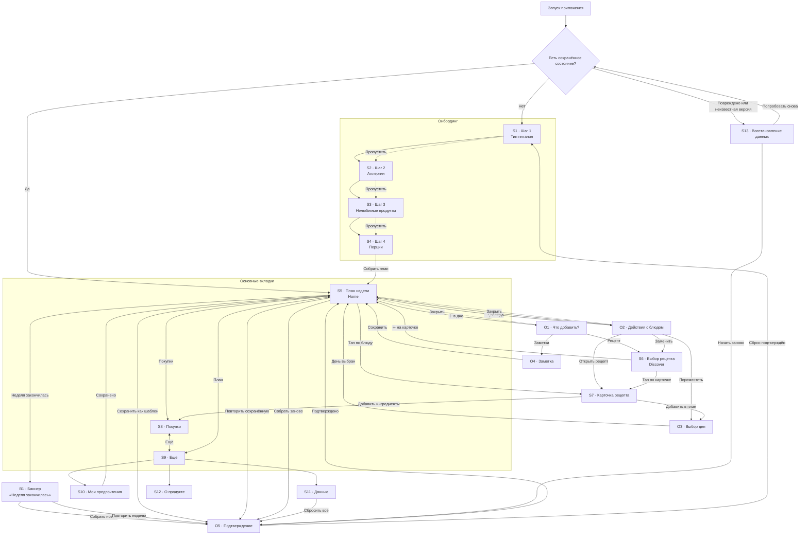
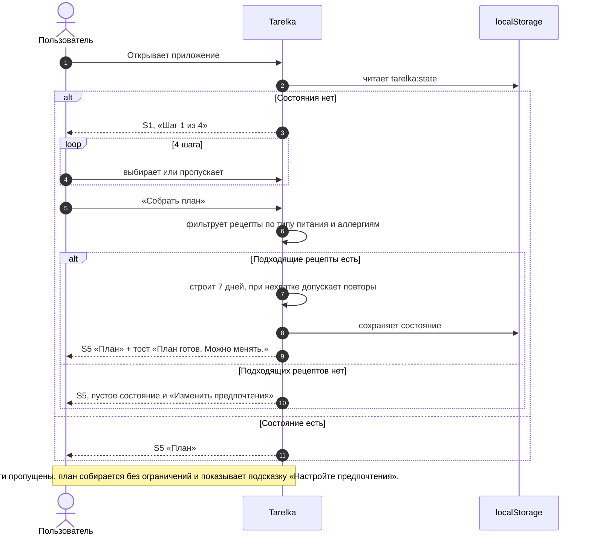
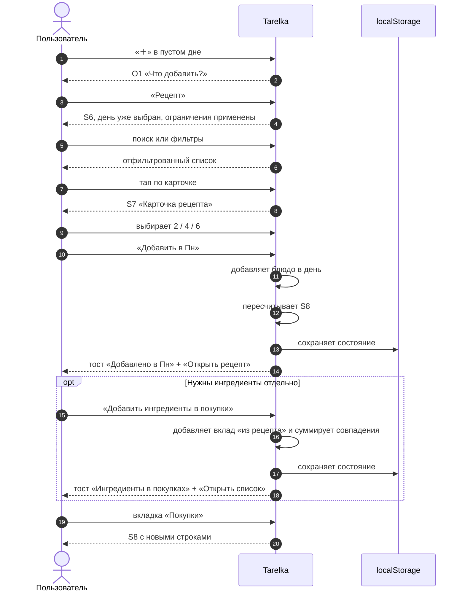
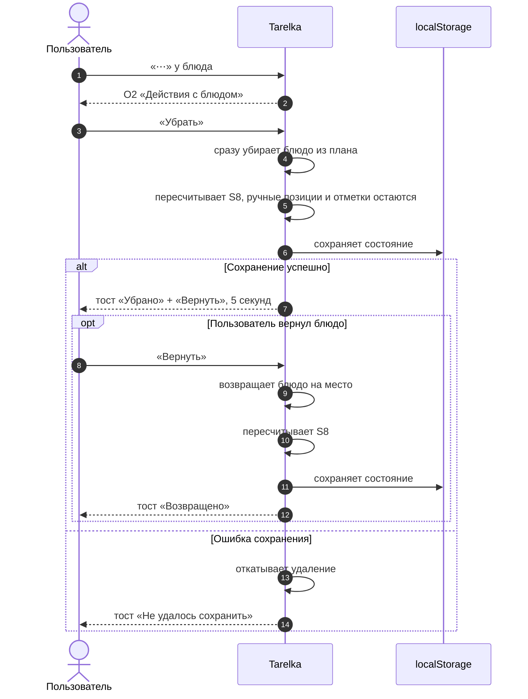

# UX-флоу Tarelka

**Версия:** 1.0  
**Дата:** 2 ноября 2026  
**Статус:** на согласование  
**Связанные документы:** `docs/prd.md`, `docs/design.md`, `docs/discussion.md`, `AGENTS.md`

> Документ описывает навигацию, состояния экранов и поведение интерфейса. Источник истины по объёму MVP — `docs/prd.md`; визуальные правила — `docs/design.md`. Документ не описывает реализацию и не добавляет функций вне границ PRD.

## 0. Соглашения

| Обозначение | Значение |
| :-- | :-- |
| **S1–S13** | Экраны приложения. |
| **O1–O5** | Полноэкранные диалоги и оверлеи. |
| **B1** | Баннер внутри экрана плана. |
| **T1** | Тоста-уведомление. |
| **Home** | Домашний экран — вкладка «План» (S5). |
| **Discover** | Выбор рецепта (S6). Не отдельная вкладка каталога. |
| **Mobile** | 360–767 px, основной сценарий одной рукой. |
| **Desktop** | ≥ 1024 px. |
| **Tablet** | 768–1023 px, промежуточный layout. |

**Границы, которые нельзя нарушать в UX-флоу:**

- Только тапы. Нет свайпов, долгих нажатий и drag-and-drop.
- Нет отдельной вкладки каталога, избранного, ленты вдохновения, режима готовки, таймеров, печати и экспорта.
- Все действия видны на экране. Скрытых жестов нет.
- Данные только в `localStorage`, без сети и аккаунтов.
- Один активный план и один сохранённый шаблон.
- Деструктивные действия либо имеют «Вернуть» на 5 секунд, либо требуют подтверждения.

## 1. Карта экранов

**Легенда.** Сплошная стрелка — основной переход. Пунктир — пропуск или закрытие без изменения данных. Возврат по «Назад» ведёт на экран-источник и на схеме отдельно не показан, чтобы не перегружать карту: S6 → S5, S7 → S6 или S5, S10–S12 → S9.

## 2. Экраны

### 2.1. S1–S4. Онбординг

**Цель:** за 4 коротких шага собрать ограничения и сразу получить первый план, а не пустой экран.

**Элементы:**

| Зона | Содержимое |
| :-- | :-- |
| **Header** | Прогресс «Шаг N из 4», кнопка «Назад» со 2-го шага, «Пропустить». На шаге 1 «Назад» нет. |
| **Контент, шаг 1** | Заголовок «Как вы питаетесь?», 4 варианта: без ограничений, много белка, лёгкое, щадящее. Выбор ровно одного. |
| **Контент, шаг 2** | Заголовок про аллергии, мультивыбор чипами, выбранные видны отдельно, дисклеймер о проверке состава. |
| **Контент, шаг 3** | Поиск по каталогу ингредиентов, результаты, выбранные чипы. Свободного ввода нет. |
| **Контент, шаг 4** | Порции 2 / 4 / 6. Пояснение, что количества пересчитаются. |
| **CTA** | «Дальше» на шагах 1–3, «Собрать план» на шаге 4. «Пропустить» не сбрасывает уже выбранное. |

**Состояния:**

| Состояние | Что видит пользователь | Поведение |
| :-- | :-- | :-- |
| **Empty** | Ничего не выбрано. CTA активна, потому что шаг можно пропустить. | «Дальше» и «Пропустить» ведут к следующему шагу. Пустой шаг считается «без ограничения». |
| **Loading** | Только на финальном «Собрать план»: кнопка показывает «Собираем…» и недоступна повторно. | Сборка ≤ 2 с. Старый план, если он был, не удаляется до успешной замены. |
| **Filled** | Выбранные варианты, чипы, порции. | «Назад» сохраняет выбор. После перезагрузки завершённые предпочтения остаются. |
| **Error** | Если сборка упала: спокойное сообщение и «Попробовать снова». | Пользователь остаётся на шаге 4, ответы не теряются. Пустая выдача — не ошибка, а отдельное пустое состояние плана. |

**Mobile vs desktop:**

- **Mobile:** полноэкранный поток, один вопрос на экран, отступы 16 px, CTA внизу с учётом safe-area, прогресс сверху. Клавиатура не перекрывает выбранные чипы.
- **Desktop:** та же логика в центрированной карточке максимум 560 px. Прогресс сверху, CTA внутри карточки. Нижней навигации нет.

**PRD:** US-01, US-02, US-03.

### 2.2. S5. План недели (Home)

**Цель:** показать, что готовим сегодня и на неделе, и дать точку входа во все действия с планом.

**Элементы:**

| Зона | Содержимое |
| :-- | :-- |
| **Header** | «План», диапазон недели «2–8 ноября», меню «⋯»: сохранить шаблон, повторить сохранённую неделю, собрать заново. |
| **Баннеры** | «Эта неделя закончилась» с двумя действиями; «В плане есть блюда с новыми ограничениями»; «Данные не сохранятся» при недоступном `localStorage`. |
| **Контент** | 7 дней пн–вс с датами. Сегодняшний день помечен «Сегодня» и `aria-current="date"`. В дне: заметка над блюдами, карточки блюд с фото, названием, временем и порциями, кнопка «＋». |
| **CTA** | «＋» в каждом дне; «⋯» у блюда; нижние вкладки «План», «Покупки», «Ещё». |
| **Пустое состояние** | «Давайте соберём первую неделю» + «Собрать автоматически» / «Добавить вручную». |

**Состояния:**

| Состояние | Что видит пользователь | Поведение |
| :-- | :-- | :-- |
| **Empty** | Обучающее пустое состояние, а не пустая сетка. | «Собрать автоматически» запускает автоподбор. «Добавить вручную» открывает добавление в день. |
| **Loading** | При «Собрать заново» кнопка в состоянии загрузки, план остаётся видимым до успеха. | Повторное нажатие заблокировано. При ошибке старый план не теряется. |
| **Filled** | 7 дней, блюда, заметки, порции. Сегодняшний день выделен и прокручен в зону видимости. | Любое изменение сразу отражается в «Покупках». |
| **Error** | Ошибка записи: тост «Не удалось сохранить» и откат изменения. Повреждённое состояние — переход на S13. | Ошибка автоподбора: сообщение и старый план. Ошибка чтения не маскируется пустым планом. |
| **Week ended** | Баннер B1 сверху, старый план остаётся видимым. | «Собрать новую» очищает план и отметки, сохраняет ручные позиции. «Повторить» копирует блюда, порции и заметки. |
| **New restrictions** | Баннер о блюдах с новыми аллергенами и бейджи у блюд. | «Пересобрать план» или «Оставить». Молча план не удаляется. |

**Mobile vs desktop:**

- **Mobile:** одна колонка, дни идут вертикально, нижняя навигация закреплена, отступы 16 px, карточки на всю ширину. Сегодняшний день прокручивается в видимую область.
- **Desktop:** контент до 1080 px, дни в 2 колонки (4 + 3), чтобы не растягивать карточки. Нижняя навигация превращается в левый rail с теми же тремя пунктами. Заголовок недели закреплён сверху.

**PRD:** US-04, US-05, US-06, US-07, US-08, US-09, US-20.

### 2.3. S6. Выбор рецепта (Discover)

**Цель:** быстро найти рецепт под день и ограничения, не уходя в отдельный каталог.

**Элементы:**

| Зона | Содержимое |
| :-- | :-- |
| **Header** | «Назад» или «Закрыть», заголовок «Добавить в Пн, 2 ноя» или «Заменить блюдо». |
| **Поиск** | Поле с подписью «Поиск по названию или ингредиенту», кнопка очистки с `aria-label`. |
| **Ограничения** | Строка «Учитываем: без глютена, без орехов» и кнопка «Изменить». Жёсткие ограничения не показываются как снимаемые чипы. |
| **Фильтры** | Чипы времени и типа блюда, «Сбросить фильтры». Горизонтальный скролл на мобиле, перенос на десктопе. |
| **Контент** | Счётчик результатов и список карточек рецептов. У нелюбимого продукта — бейдж «Содержит …». |
| **CTA** | «＋» на карточке добавляет в день сразу. Тап по карточке открывает S7. |

**Состояния:**

| Состояние | Что видит пользователь | Поведение |
| :-- | :-- | :-- |
| **Empty** | «Ничего не нашли по запросу «…»» или «Под эти условия пока нет рецептов», активные фильтры и действия. | «Очистить поиск» и «Сбросить фильтры» разделены. Аллергии и тип питания не снимаются. |
| **Loading** | Если локальный каталог читается дольше 150 мс — скелетон карточек. Обычно данные уже в памяти. | Скелетон не мигает при быстром чтении. Поиск и фильтры не блокируют ввод. |
| **Filled** | Отсортированный список, активные чипы, количество результатов. | Результаты озвучиваются, `aria-pressed` отражает состояние чипов. |
| **Error** | «Не удалось загрузить рецепты» и «Попробовать снова». | План и покупки не меняются. Ошибка не выглядит как пустая выдача. |

**Mobile vs desktop:**

- **Mobile:** полноэкранный экран, поиск и чипы закреплены сверху, список в одну колонку. Клавиатура не закрывает первые результаты.
- **Desktop:** модальное окно до 760 px и 80vh, либо отдельный экран при прямом переходе. Карточки в 2 колонки, чипы переносятся, а не скроллятся горизонтально.

**PRD:** US-10, US-11, US-12.

### 2.4. S7. Карточка рецепта

**Цель:** понять, стоит ли готовить блюдо, и добавить его в план или ингредиенты в покупки.

**Элементы:**

| Зона | Содержимое |
| :-- | :-- |
| **Header** | «Назад» или «Закрыть», заголовок появляется при прокрутке. |
| **Контент** | Крупное фото с alt, название, вступление 1–2 предложения, время, базовые порции, теги, выбор 2 / 4 / 6, ингредиенты, пронумерованные шаги, дисклеймер по аллергенам. |
| **Дополнительно** | «Уже в плане: Пн, Чт», бейдж несоответствия новым ограничениям, «содержит …» для нелюбимого продукта. |
| **CTA** | Основная кнопка «Добавить в Пн» или «Добавить в план». Вторичная «Добавить ингредиенты в покупки». |

**Состояния:**

| Состояние | Что видит пользователь | Поведение |
| :-- | :-- | :-- |
| **Empty** | Не применимо для валидного рецепта. Для неизвестного ID — «Рецепт не найден» и «Назад». | Пустой экран не показывается. |
| **Loading** | Локальные данные, поэтому загрузки обычно нет. Фото — с `loading="lazy"` и заданными размерами. | Нет «прыжка» макета. |
| **Filled** | Полный рецепт, пересчитанные количества, актуальные порции. | Смена порций сразу пересчитывает ингредиенты. Из плана — обновляет блюдо, из выбора — только будущее добавление. |
| **Error** | Заглушка изображения с названием блюда. Если данных нет — объяснение и «Назад». | Офлайн и отсутствие фото не ломают макет. |
| **Portion edge case** | Штучные округляются вверх, граммы и миллилитры не переводятся, «по вкусу» не умножается. | Показывается не больше одного знака после запятой. |

**Mobile vs desktop:**

- **Mobile:** одна колонка, фото 16:9, основная кнопка в закреплённой панели над safe-area, вторичное действие рядом или под ней. Горизонтальной прокрутки нет на 320 px.
- **Desktop:** две колонки: слева фото и краткая сводка, справа ингредиенты и шаги. Блок действий закреплён в правой колонке. Максимум 960 px.

**PRD:** US-13, US-14, US-15.

### 2.5. S8. Покупки

**Цель:** показать весь список по отделам и дать отмечать купленное одним тапом, не теряя ручные позиции.

**Элементы:**

| Зона | Содержимое |
| :-- | :-- |
| **Header** | «Покупки», прогресс «6 из 12», при 100% — «Всё куплено». |
| **Добавление** | Поле «Что купить?», подсказки из каталога и ручных позиций, количество, единица, кнопка «Добавить». |
| **Контент** | Группы по 7 отделам в фиксированном порядке. Строки с чекбоксом, названием, количеством и единицей. Бейджи «вручную», «из рецепта», «по вкусу». Предупреждение при разных единицах. |
| **CTA** | «Добавить» в форме. Нижние вкладки. Кнопки «Обновить» нет. |

**Состояния:**

| Состояние | Что видит пользователь | Поведение |
| :-- | :-- | :-- |
| **Empty** | «Пока тут пусто. Добавьте блюда в план — список соберётся сам.» Если плана нет, форма добавления остаётся доступной. | Ручные позиции можно добавить и без плана. |
| **Loading** | Отдельной загрузки нет: список производный и пересчитывается сразу. | При первом чтении допустим скелетон, если данные читаются дольше 150 мс. |
| **Filled** | Сгруппированный список, прогресс, отметки, ручные позиции. | Отметка сохраняется у строки с тем же именем и единицей. Список не исчезает при 100%. |
| **Error** | При ошибке записи — тост и откат отметки. При недоступном хранилище — баннер «Данные не сохранятся». | Ошибка одной строки не ломает остальной список. |
| **Mixed units** | Две строки с предупреждением «Проверьте количество: разные единицы». | Автоматического перевода нет. Это предупреждение, не ошибка. |

**Mobile vs desktop:**

- **Mobile:** одна колонка, форма добавления сверху, крупные строки от 56 px, чекбокс с зоной 44×44, нижняя навигация. Прогресс виден при прокрутке.
- **Desktop:** максимум 760 px по центру, одна колонка для быстрого сканирования. Форма закреплена сверху. Отделы не разъезжаются в несколько колонок.

**PRD:** US-16, US-17, US-18, US-19.

### 2.6. S9. Ещё

**Цель:** собрать в одном месте предпочтения, данные и информацию о продукте, не засоряя основные вкладки.

**Элементы:**

| Зона | Содержимое |
| :-- | :-- |
| **Header** | «Ещё». |
| **Контент** | «Мои предпочтения» с краткой сводкой; статус шаблона «Сохранённая неделя»; «Данные»; «О продукте»; версия приложения. |
| **CTA** | Строки-переходы. Отдельной кнопки нет. |

**Состояния:**

| Состояние | Что видит пользователь | Поведение |
| :-- | :-- | :-- |
| **Empty** | Не применимо: экран всегда содержит настройки и информацию. | — |
| **Loading** | Не применимо: локальные данные. | — |
| **Filled** | Список разделов и сводка предпочтений. | Сводка обновляется после сохранения настроек. |
| **Error** | Баннер «Данные не сохранятся», если `localStorage` недоступен. | Остальные разделы остаются доступными. |

**Mobile vs desktop:**

- **Mobile:** одна колонка, крупные строки, нижняя навигация.
- **Desktop:** максимум 720 px, левый rail. Строки остаются списком, не превращаются в плитку.

**PRD:** US-03, US-08, US-20, US-21.

### 2.7. S10. Мои предпочтения

**Цель:** изменить тип питания, аллергии, нелюбимые продукты и порции, не проходя онбординг заново.

**Элементы:**

| Зона | Содержимое |
| :-- | :-- |
| **Header** | «Назад», «Мои предпочтения». |
| **Контент** | 4 раздела: тип питания, аллергии, нелюбимые продукты, порции. Те же контролы, что в онбординге. Поиск по каталогу ингредиентов для нелюбимых. |
| **CTA** | «Сохранить». При изменении аллергий — объяснение, что план может потребовать пересборки. |

**Состояния:**

| Состояние | Что видит пользователь | Поведение |
| :-- | :-- | :-- |
| **Empty** | Нелюбимые продукты не выбраны; тип питания «Без ограничений»; аллергии не выбраны. | Это валидное состояние, а не ошибка. |
| **Loading** | Сохранение локальное; кнопка кратко показывает занятость, если запись не мгновенная. | Повторное нажатие блокируется. |
| **Filled** | Выбранные ограничения и порции, заметные изменения. | «Сохранить» применяет настройки к следующему автоподбору и выбору рецепта. |
| **Error** | «Не удалось сохранить настройки» и повтор. | Изменения не теряются в форме. |
| **Conflict** | Если новая аллергия конфликтует с текущим планом, после сохранения на S5 показывается баннер. | «Пересобрать план» или «Оставить»; молча ничего не удаляется. |

**Mobile vs desktop:**

- **Mobile:** полноэкранный экран, секции вертикально, CTA внизу.
- **Desktop:** модальное окно до 720 px или отдельный экран. Секции можно оставить в одну колонку для предсказуемости.

**PRD:** US-02, US-03, US-20.

### 2.8. S11. Данные

**Цель:** дать понятный способ начать заново и объяснить, что происходит с локальными данными.

**Элементы:**

| Зона | Содержимое |
| :-- | :-- |
| **Header** | «Назад», «Данные». |
| **Контент** | Статус хранения, объяснение «Данные хранятся только на этом устройстве», кнопка «Сбросить всё». Информация о резервной копии повреждённого состояния без технических деталей. |
| **CTA** | «Сбросить всё» — опасное действие, открывает O5. |

**Состояния:**

| Состояние | Что видит пользователь | Поведение |
| :-- | :-- | :-- |
| **Empty** | Не применимо. | — |
| **Loading** | После подтверждения — короткое состояние сброса. | Кнопки недоступны, чтобы не запустить сброс дважды. |
| **Filled** | Статус, объяснение, кнопка сброса. | — |
| **Error** | «Не удалось сбросить данные» и повтор. | Данные не удаляются частично. |

**Mobile vs desktop:**

- **Mobile:** полноэкранный экран, предупреждение и кнопка внизу.
- **Desktop:** модальное окно до 560 px.

**PRD:** US-21, NFR-D3, NFR-D4.

### 2.9. S12. О продукте

**Цель:** объяснить, что такое Tarelka, снять медицинские ожидания и показать источники.

**Элементы:**

| Зона | Содержимое |
| :-- | :-- |
| **Header** | «Назад», «О продукте». |
| **Контент** | Короткое описание, дисклеймер по аллергенам, «Данные не покидают устройство», источники изображений, версия. |
| **CTA** | Нет. |

**Состояния:**

| Состояние | Что видит пользователь | Поведение |
| :-- | :-- | :-- |
| **Empty** | Не применимо. | — |
| **Loading** | Не применимо. | — |
| **Filled** | Статический текст и версия. | — |
| **Error** | Только глобальный сбой чтения состояния, который уводит на S13. | — |

**Mobile vs desktop:**

- **Mobile:** одна колонка, максимум 720 px, обычный скролл.
- **Desktop:** та же колонка по центру.

**PRD:** A10, NFR-D2.

### 2.10. S13. Восстановление данных

**Цель:** не падать и не перезаписывать повреждённые данные молча.

**Элементы:**

| Зона | Содержимое |
| :-- | :-- |
| **Header** | «Не удалось прочитать данные». |
| **Контент** | Спокойное объяснение, что данные повреждены или версия неизвестна, что сохранена резервная копия, и что оригинал не перезаписан. |
| **CTA** | «Попробовать снова», «Начать заново». «Начать заново» открывает O5. |

**Состояния:**

| Состояние | Что видит пользователь | Поведение |
| :-- | :-- | :-- |
| **Empty** | Не применимо: это не пустой экран, а состояние ошибки. | — |
| **Loading** | «Попробовать снова» показывает повторное чтение. | При успехе — S5; при повторной ошибке — тот же экран с тем же объяснением. |
| **Filled** | Не применимо. | — |
| **Error** | Основное состояние экрана. | Сырое значение копируется в отдельный ключ резервной копии; оригинал не перезаписывается до явного сброса. |

**Mobile vs desktop:**

- **Mobile:** центрированная карточка, крупные кнопки, без нижней навигации.
- **Desktop:** центрированная карточка до 560 px.

**PRD:** US-21, NFR-D1, NFR-D3.

### 2.11. Оверлеи и баннеры

| ID | Название | Цель | Элементы | Состояния |
| :-- | :-- | :-- | :-- | :-- |
| **O1** | Что добавить? | Выбрать тип добавления в день. | «Рецепт», «Заметка», «Закрыть». | Всегда заполнен; закрытие без изменений. |
| **O2** | Действия с блюдом | Дать видимые действия без скрытых жестов. | «Открыть рецепт», «Переместить», «Заменить», «Убрать», «Закрыть». | Заполнен; «Убрать» сразу удаляет с undo. |
| **O3** | Выбор дня | Добавить или переместить блюдо. | 7 дней с датами, «Сегодня», количество блюд, текущий день недоступен при перемещении. | Заполнен; закрытие без изменений. |
| **O4** | Заметка | Записать «ужин в гостях» или «остатки». | Поле до 120 символов, счётчик, «Сохранить», «Отмена». | Empty — сохранение недоступно; filled — сохраняется; ошибка — сообщение у поля. |
| **O5** | Подтверждение | Защитить необратимые действия. | Заголовок, последствия, «Отмена» с фокусом по умолчанию, опасное действие. | Варианты: сохранить шаблон, применить шаблон, пересобрать план, сбросить всё. |
| **B1** | Баннер недели | Объяснить, что сохранённая неделя закончилась. | «Эта неделя закончилась», «Собрать новую неделю», «Повторить эту неделю». | Показывается только вне текущей недели; старый план остаётся. |
| **T1** | Тост | Подтвердить действие и дать отмену. | Текст, действие «Вернуть» или «Открыть», закрытие. | 5 с для undo, 3 с для информации; один активный тост. |

## 3. Основные флоу

### 3.1. Онбординг → Home

**Результат:** пользователь попадает на Home с готовым планом или с честным пустым состоянием, а не в пустую сетку. Ошибка сборки оставляет его на шаге 4 с сохранёнными ответами.

### 3.2. Пустая ячейка → Discover → Recipe → Shopping

**Варианты:**

- Если нажать «＋» прямо на карточке в S6, рецепт добавляется в уже выбранный день без перехода в S7.
- Если открыть S6 из «Заменить», выбор нового рецепта заменяет блюдо в том же дне и на той же позиции.
- Если из S6 закрыть без выбора, план не меняется.

### 3.3. Удаление из плана

**Правила:**

- Удаление не требует подтверждения: защита — undo на 5 секунд, как в PRD US-06.
- Автопозиции удалённого блюда исчезают из покупок; ручные позиции и отметки остальных строк сохраняются.
- Если истекло 5 секунд, удаление фиксируется. Новое действие завершает предыдущий undo-контекст.
- «Вернуть» возвращает блюдо на прежнее место в дне.

## 4. Паттерны взаимодействия

### 4.1. Диалоги: mobile и desktop

> **Важно:** запрос «bottom sheet на мобиле» конфликтует с PRD A5, где вместо bottom sheet зафиксированы полноэкранные диалоги и экраны. В MVP используется канонический вариант ниже. Bottom sheet остаётся справочной схемой в `docs/design.md` и не реализуется без пересмотра A5.

| Параметр | Mobile (360–767) | Desktop (≥ 1024) |
| :-- | :-- | :-- |
| **Форма** | Полноэкранный диалог на весь viewport. | Центрированное модальное окно: 560–760 px, максимум 80vh. |
| **Фон** | `--color-bg`, без затемнения страницы. | Затемнение `rgba(46, 38, 34, 0.32)`, окно `--color-surface`, `--radius-xl`, `--shadow-lg`. |
| **Header** | «Назад» или «X» 44×44, заголовок, без лишних действий. | «X» 44×44, заголовок. |
| **Футер** | Закреплённая панель действий над safe-area. | Закреплённый футер внутри окна. |
| **Закрытие** | Видимая кнопка, `Esc`, системная «Назад». | «X», `Esc`, клик по затемнению для меню; для форм с вводом — только явное закрытие. |
| **Фокус** | Захват внутри, начальный фокус на первом действии или «X», возврат на кнопку-источник. | То же. |
| **Скролл** | Блокируется body, скроллится только контент. | Блокируется body, скроллится только окно. |
| **Жесты** | Нет свайпа для закрытия. | Нет drag. |
| **Bottom sheet** | Не используется. | Не используется. |

**Почему так:** полноэкранный диалог даёт крупные зоны, не конфликтует с нижней навигацией и не требует жеста, который трудно обнаружить. Модальное окно на десктопе сохраняет контекст страницы.

### 4.2. Toast-нотификации

| Параметр | Правило |
| :-- | :-- |
| **Позиция** | Mobile: над нижней навигацией с учётом safe-area, отступы 16 px. Desktop: снизу по центру, максимум 480 px. |
| **Длительность** | 5 с для действия «Вернуть»; 3 с для информационного тоста. Пауза при фокусе или наведении. |
| **Количество** | Один видимый тост. Новые встают в очередь, не наслаиваются. |
| **Действие** | Кнопка «Вернуть» или «Открыть» не меньше 44×44, не исчезает раньше текста. |
| **Доступность** | `role="status"`, `aria-live="polite"`. Для ошибки — `role="alert"`. Тост не забирает фокус. |
| **Содержание** | Коротко: что произошло и что можно сделать. Без «Успешно!» и без канцелярита. |
| **Ограничение** | Тост не заменяет поле с ошибкой и не используется для блокирующих проблем. |

**Примеры:**

- «Добавлено в Пн» + «Открыть рецепт».
- «Убрано» + «Вернуть».
- «Ингредиенты в покупках» + «Открыть список».
- «Шаблон сохранён».
- «Не удалось сохранить» — без действия, если повтор невозможен.

### 4.3. Оптимистичное обновление

Действие сначала применяется в интерфейсе, затем сохраняется. Если запись не удалась, интерфейс откатывается и сообщает об ошибке. Это соответствует NFR-P3: отклик ≤ 100 мс, пересчёт покупок ≤ 50 мс.

| Действие | Оптимистично | Подтверждение | Undo | Что пересчитывается |
| :-- | :-- | :-- | :-- | :-- |
| Отметить покупку | Да | Нет | Нет, повторный тап снимает | Прогресс, `aria-checked` |
| Убрать блюдо | Да | Нет | Да, 5 с | План, покупки, прогресс |
| Переместить блюдо | Да | Нет | Да, 5 с | План, порядок дней |
| Заменить блюдо | Да | Нет | Да, 5 с | План, покупки |
| Изменить порции | Да | Нет | Да, 5 с | Блюдо, покупки |
| Добавить ручную позицию | Да | Нет | Через удаление строки | Покупки, прогресс |
| Добавить ингредиенты из рецепта | Да | Нет | Через удаление вклада | Покупки, прогресс |
| Применить шаблон | После подтверждения | Да | Нет | План, покупки |
| Собрать заново | Нет, сначала загрузка | Да | Нет | План, покупки |
| Сбросить всё | Нет | Да, двойное подтверждение | Нет | Всё состояние |
| Завершить онбординг | Нет, сначала сборка | Нет | Нет | План, покупки |

**Порядок выполнения:**

1. Пользователь нажимает действие.
2. Состояние меняется в памяти, интерфейс обновляется сразу.
3. Производные данные (покупки, прогресс) пересчитываются синхронно.
4. Состояние пишется в `tarelka:state`.
5. При ошибке записи — откат к снимку до действия и тост об ошибке.
6. При успехе — тост с undo, если действие обратимо.

**Что важно не сломать:**

- Ручные позиции и отметки не должны исчезать при пересчёте покупок.
- Отметка привязана к нормализованному имени и единице, а не к позиции в массиве.
- Если строка исчезла из автопозиций, её отметка не восстанавливается сама.
- Один undo-контекст: новое обратимое действие фиксирует предыдущее.

### 4.4. Навигация и «Назад»

| Ситуация | Поведение |
| :-- | :-- |
| Переключение вкладок | Сохраняется позиция прокрутки каждой вкладки. |
| Открытие S6, S7, S10–S12 | Добавляется шаг навигации; «Назад» возвращает на источник с сохранённой прокруткой. |
| Открыт оверлей | Системная «Назад» и `Esc` закрывают сначала оверлей, потом экран. |
| Закрытие оверлея | Фокус возвращается на кнопку, которая его открыла. |
| Сброс данных | После подтверждения история очищается и открывается S1. |
| Восстановление после ошибки | «Начать заново» ведёт на S1, «Попробовать снова» остаётся на S13 при повторной ошибке. |

**Правило:** никаких ловушек истории. Пользователь всегда может выйти назад или закрыть диалог видимой кнопкой.

### 4.5. Иерархия загрузки, пустоты и ошибок

| Уровень | Когда используем | Пример |
| :-- | :-- | :-- |
| **Поле** | Ошибка ввода. | Пустое название ручной позиции, количество ≤ 0. Сообщение связано через `aria-describedby`. |
| **Тост** | Действие не удалось сохранить, но экран работает. | «Не удалось сохранить», откат. |
| **Баннер** | Проблема влияет на часть экрана. | «Данные не сохранятся», «В плане есть блюда с новыми ограничениями», «Неделя закончилась». |
| **Пустое состояние** | Данных нет по объективной причине. | Нет плана, нет результатов поиска, нет покупок. |
| **Экран восстановления** | Данные повреждены, приложение не может продолжить. | S13. |

**Загрузка:**

- Локальные чтения не показывают спиннер, если укладываются в 150 мс.
- Скелетон допустим только для каталога и списка при первом чтении.
- Автоподбор показывает занятость кнопки, а не блокирующий спиннер на весь экран.
- Изображения не резервируют место скачком: заданы `width` и `height`.

### 4.6. Адаптивность

| Диапазон | Навигация | Контент | Диалоги |
| :-- | :-- | :-- | :-- |
| **320–479** | Нижние вкладки, safe-area | 1 колонка, отступы 16 px, карточки на всю ширину | Полноэкранные |
| **480–767** | Нижние вкладки | 1 колонка, максимум 560 px | Полноэкранные |
| **768–1023** | Нижние вкладки | 1 колонка, максимум 720 px; план можно оставить в 1 колонку | Модальные окна 640 px |
| **≥ 1024** | Левый rail с теми же 3 пунктами | До 1080 px; план в 2 колонки; рецепт в 2 колонки | Модальные окна 560–760 px |

**Правила:**

- Ниже 320 px горизонтальной прокрутки нет; текст переносится, а не обрезается.
- На десктопе строки списка не растягиваются на всю ширину монитора.
- На планшете не появляется четвёртая вкладка и не добавляется новый раздел.
- При 200% масштабе контент не теряется, кнопки не наезжают друг на друга.

### 4.7. Доступность флоу

- Все интерактивные элементы доступны с клавиатуры: `Tab`, `Shift+Tab`, `Enter`, `Space`, `Esc`.
- Фокус видим: `outline: 3px solid var(--color-focus)`, `outline-offset: 2px`.
- В диалогах фокус захвачен, `Esc` закрывает, после закрытия фокус возвращается на инициатор.
- Зоны нажатия не меньше 44×44 px, расстояние между ними не меньше 8 px.
- Сегодняшний день: `aria-current="date"`. Активная вкладка: `aria-current="page"`. Чипы: `aria-pressed`. Чекбоксы: `aria-checked`.
- Прогресс покупок, количество результатов фильтра и тосты объявляются через `aria-live="polite"`.
- Смысл не передаётся только цветом: у бейджей и состояний есть текст или иконка с подписью.
- Изображения с осмысленным alt; декоративные иконки — `aria-hidden="true"`.
- `prefers-reduced-motion` отключает переходы; анимации не длиннее 250 мс.
- Ошибки формы связаны с полями и понятны без контекста.

### 4.8. Тон в состояниях

| Ситуация | Не пишем | Пишем |
| :-- | :-- | :-- |
| Нет плана | «План пуст. Ошибка.» | «Давайте соберём первую неделю». |
| Нет результатов | «Результатов не найдено.» | «Ничего не нашли по запросу «кур».» + «Очистить поиск». |
| Нет покупок | «Список пуст.» | «Пока тут пусто. Добавьте блюда в план — список соберётся сам.» |
| Ошибка сохранения | «Ошибка 500.» | «Не удалось сохранить. Попробуйте ещё раз.» |
| Аллергии | «Безопасно для аллергиков.» | «Мы исключаем рецепты с выбранными аллергенами, но состав продуктов может меняться. Проверяйте упаковку и состав.» |
| Сброс | «Вы уверены?» | «Сбросить все данные? План, покупки и настройки исчезнут. Это нельзя отменить.» |

## 5. Связь с PRD

| Экран | Истории |
| :-- | :-- |
| S1–S4 Онбординг | US-01, US-02, US-03 |
| S5 План | US-04, US-05, US-06, US-07, US-08, US-09, US-20 |
| S6 Discover | US-10, US-11, US-12 |
| S7 Рецепт | US-13, US-14, US-15 |
| S8 Покупки | US-16, US-17, US-18, US-19 |
| S9 Ещё | US-03, US-08, US-20, US-21 |
| S10 Предпочтения | US-02, US-03, US-20 |
| S11 Данные | US-21 |
| S12 О продукте | A10, NFR-D2 |
| S13 Восстановление | US-21 |

## 6. UX-решения, требующие подтверждения

Эти пункты не меняют объём MVP, но фиксируют поведение, которого нет в PRD дословно:

1. **Desktop-адаптация.** Левый rail вместо нижних вкладок и две колонки дней на ≥ 1024 px. Это адаптация NFR-D9, а не новый раздел.
2. **Полноэкранный диалог вместо bottom sheet.** Соответствует PRD A5. Если нужен именно bottom sheet на мобиле, сначала меняем A5 и `docs/design.md`.
3. **Один undo-контекст.** Новое обратимое действие фиксирует предыдущее; второй тост не наслаивается.
4. **Возврат фокуса и прокрутки.** После закрытия диалога и возврата с S7 сохраняется позиция исходного экрана.
